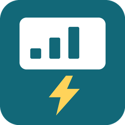

# Appliance Meter

Track appliance power, energy and electricity costs in Home Assistant, using the
meters you already have.

A **logical appliance** is the stable Home Assistant device created by this
integration. A **physical meter** supplies its readings. You can replace that meter
without creating a new appliance or losing the logical appliance's accumulated
totals and entity identities.

## What it does

- Creates Power, Energy Total, Cost Total and Unpriced Energy sensors per appliance.
- Keeps Decimal energy/cost totals and source baselines across restarts.
- Combines appliances into Custom Totals without counting a member twice.
- Provides one Appliance Meter page for consumption, source selection and administration.
- Shows missing period history and unpriced consumption explicitly.

Energy comes from changes in a cumulative Wh/kWh meter. Lifetime cost uses the
valid price **when each change is observed**; it does not reconstruct past prices
or reprice old consumption. A missing price increases Unpriced Energy.
[Accounting and limitations](docs/accounting.md).

## Install with HACS

Add `https://github.com/MyHAEsp/ha-appliance-meter` as a **custom repository** of type
**Integration** in HACS, download it, then restart Home Assistant. In
**Settings → Devices & services → Add integration**, select **Appliance Meter**.
Custom-repository installation does not imply inclusion in the HACS default catalog.

Home Assistant 2026.10.4 is the tested version.
[Installation and upgrades](docs/installation.md).

## Create your first appliance

1. Name the logical appliance and select its physical device.
2. Review the proposed Power and Energy sensors; select the correct sources.
3. Optionally choose an inclusive electricity-price sensor in your accounting currency.
4. Open **Appliance Meter** in the sidebar to view consumption or edit the appliance.

The first valid physical counter establishes a baseline; its existing lifetime
reading is not imported. Appliance Meter observes readings and does not start or
control the appliance.

## Replace a meter

Edit the **existing** appliance and change its source assignments while it is
idle. Keep the appliance rather than deleting and recreating it. Logical totals
and IDs remain; the new meter's first valid reading establishes a fresh baseline.
Consumption before that baseline cannot be recovered automatically.
[Source changes and compatibility](docs/source-mapping.md).

## Optional session observation

Version 0.2.1 includes **Off / Shadow** session observation, historical session
pricing, quality flags and a diagnostic sensor. Existing entries default to Off. Dishwasher completion remains an unverified candidate; observations
never control appliances or update learning helpers.

Session history is available through an administrator read-only API, not a new
session-history dashboard. [Session guide](docs/sessions.md) ·
[Activation and rollback](docs/activation-rollback.md).

## More information

- [Dashboard, period coverage and Custom Totals](docs/consumption-dashboard.md)
- [Accounting and currency](docs/accounting.md)
- [Source discovery and energy resolution](docs/energy-resolution.md)
- [Development and synthetic tests](docs/development.md)
- [Release checks](docs/releasing.md)

[MIT License](LICENSE) · Maintainer: [@SysAdminDk](https://github.com/SysAdminDk)
